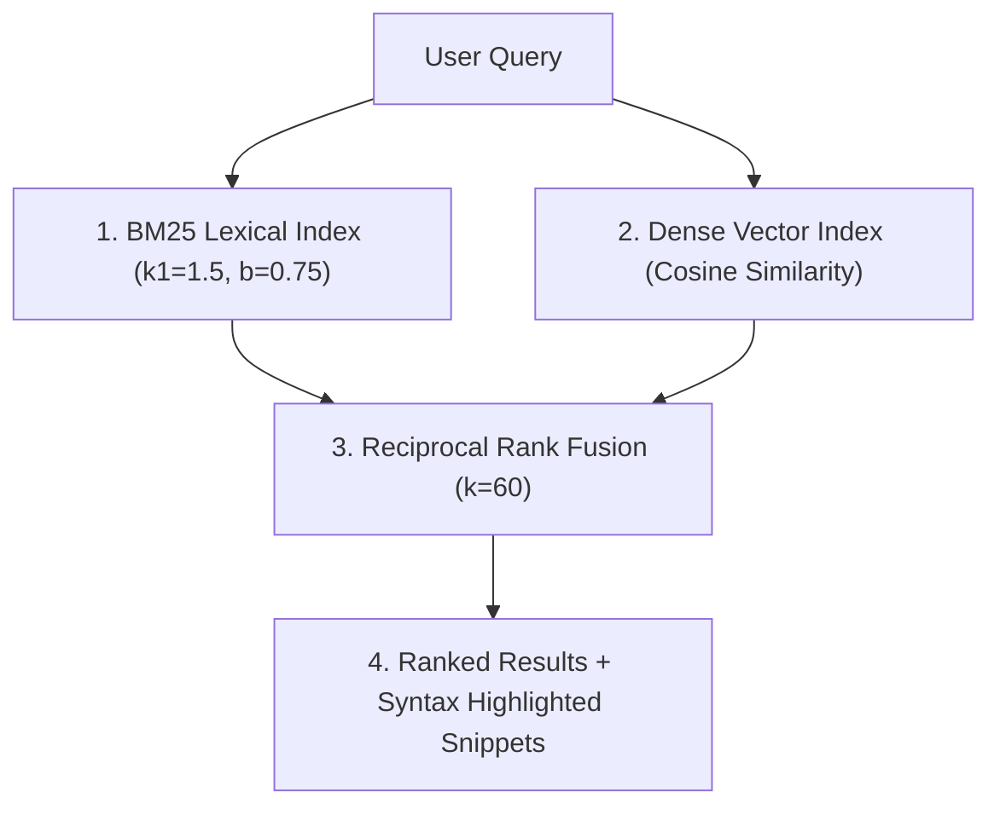

<div align="center">

# 🔍 NovaSearch

### Production-Grade Hybrid Search Engine (BM25 + Semantic Search + Reciprocal Rank Fusion) from Scratch

[](https://www.python.org/)
[](https://opensource.org/licenses/MIT)
[](https://github.com)

*A ground-up implementation of modern search engine primitives inspired by Lucene, Elasticsearch, and Pinecone.*

</div>

---

## 💡 What is NovaSearch?

Standard keyword search engines (like basic TF-IDF) fail on synonyms and intent. Pure vector search engines fail on exact keywords, part numbers, and code identifiers.

**NovaSearch** combines the best of both worlds using **Hybrid Search**:
1. **Okapi BM25 Lexical Ranking**: Robertson-Spärck Jones IDF with term frequency saturation ($k_1$) and document length normalization ($b$).
2. **Dense Vector Semantic Matching**: Cosine similarity matching across high-dimensional embeddings.
3. **Reciprocal Rank Fusion (RRF)**: Merges lexical and vector ranking lists without requiring score normalization or weights.
4. **Local Crawler & Highlighter**: Auto-indexes directories of Markdown/code/text files and extracts colorized matching excerpts.
5. **Zero External Dependencies**: Pure standard library Python 3.



---

## 🚀 Quickstart

### 1. Search Any Folder from Terminal
```bash
# Clone the repository
git clone https://github.com/YashrajMiyatra/novasearch.git
cd novasearch

# Index and search any directory interactively
python3 -m novasearch.cli /path/to/my/docs
```

Or pass queries directly:
```bash
python3 -m novasearch.cli . -q "BM25 scoring engine"
```

### 2. Python API Usage
```python
from novasearch import NovaEngine

engine = NovaEngine()

# Index documents
engine.index_document("doc1", "Docker containerization uses Linux namespaces and cgroups.")
engine.index_document("doc2", "Kubernetes is an orchestration platform for containerized applications.")
engine.index_document("doc3", "Python is an interpreted, high-level general-purpose programming language.")

# Search
results = engine.search("container orchestration", mode="bm25", top_k=2)

for r in results:
    print(f"Rank {r['rank']} | ID: {r['id']} | Score: {r['score']}")
    print(f"Snippet: {r['snippet']}\n")
```

---

## 📐 Architecture: Reciprocal Rank Fusion (RRF)

$$\text{RRF\_Score}(d \in D) = \sum_{m \in M} \frac{1}{k + r_m(d)}$$

Where:
* $M$ is the set of retrieval models (BM25 Lexical and Vector Semantic).
* $r_m(d)$ is the document rank in model $m$.
* $k$ is the smoothing constant (default: 60).

---

## 🧪 Testing

Run the automated test suite:
```bash
python3 -m unittest discover -s tests -v
```

---

## 📜 License

MIT License. See [LICENSE](LICENSE) for details.
